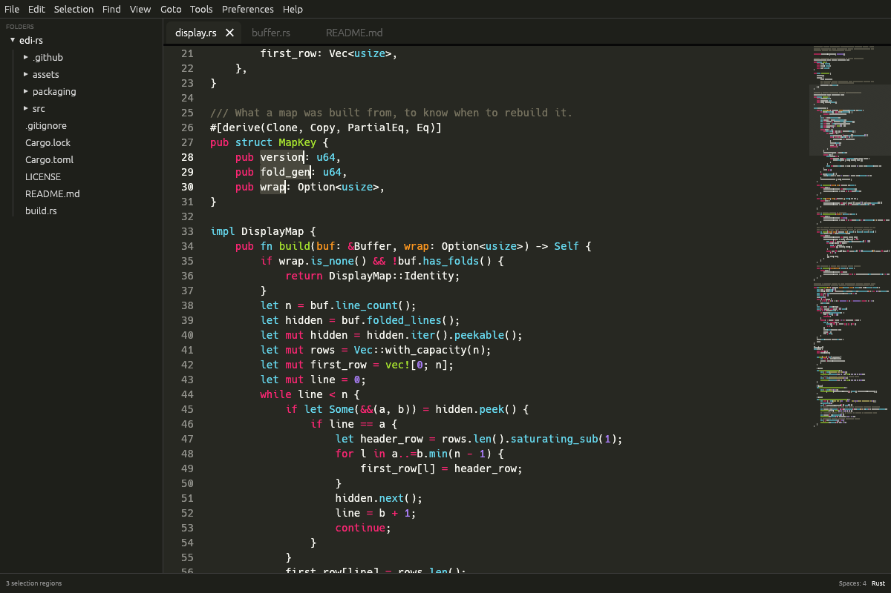
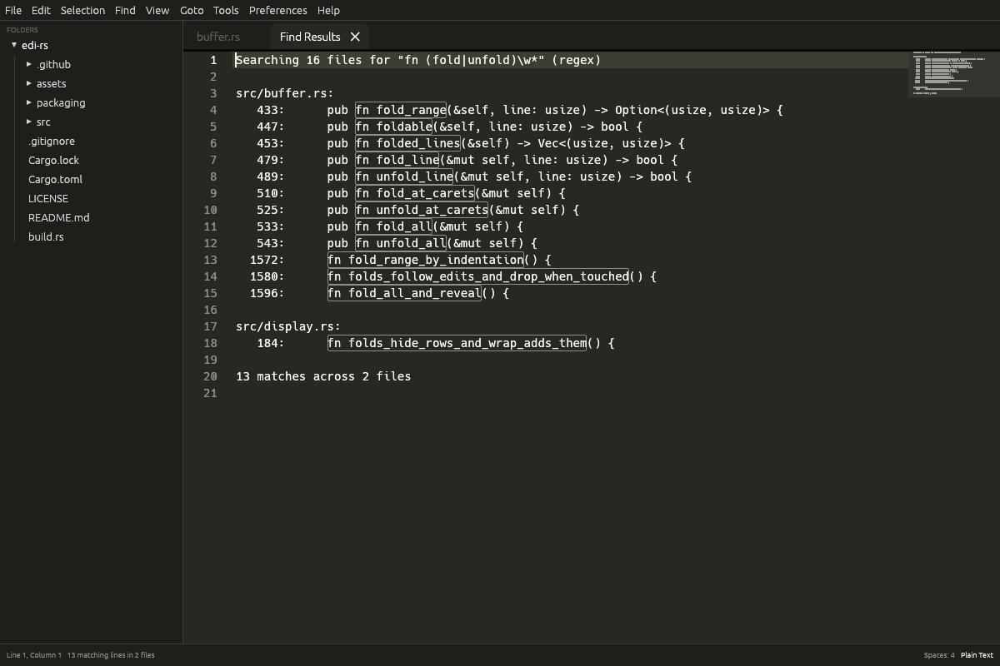
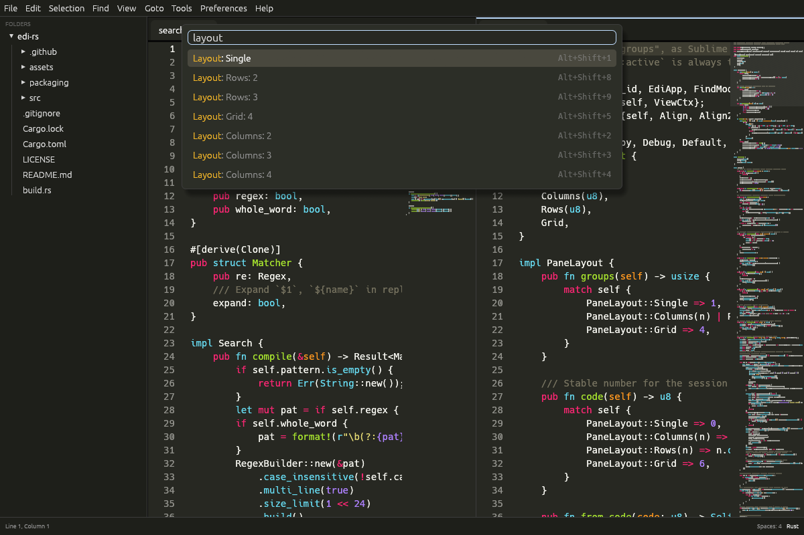
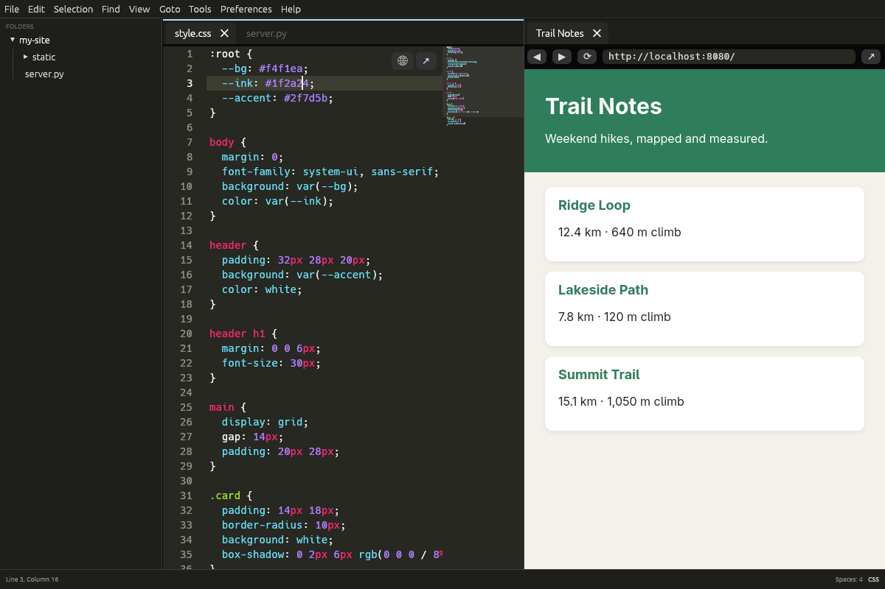

# Edi

A fast, GPU-drawn text editor written in Rust, modelled on Sublime Text's
workflow: multiple cursors, Goto Anything, a command palette, a minimap,
split panes and Sublime's default key bindings, plus a built-in browser for
previewing web pages and local web services.



Edi is a clean-room implementation: it follows Sublime Text's publicly
documented behaviour and default key bindings, and uses no Sublime code or
assets.

## Features

### Editing

- **Multiple cursors**: Ctrl+D adds the next occurrence, Ctrl+click adds a
  caret, Alt+Shift+↑/↓ adds a caret on the line above/below, Ctrl+Shift+L
  splits a selection into lines, middle-drag makes a column selection, and
  Alt+F3 selects every occurrence.
- **Sublime-style editing**: auto-paired brackets and quotes, smart indent on
  Enter, whole-line copy/cut/paste when nothing is selected, toggle comment,
  duplicate/swap/delete/join/sort lines, case conversion, jump to matching
  bracket, and undo that groups typing.
- **Pretty Print** (Ctrl+Alt+J) for JSON, XML, HTML, CSS/SCSS/Less, SQL and
  Markdown tables. It picks the format from the file type (or, for a
  selection, from what the text looks like), formats the selection or the
  whole file, and changes only whitespace, so key order, numbers and comments
  survive. *Pretty Print: …* in the Command Palette forces a format.
- **Syntax highlighting** for 68 languages (via syntect, which reads
  Sublime-format grammars), updated incrementally as you type.
- **Color schemes**: Monokai by default plus several others, with live preview
  (*Preferences › Select Color Scheme…*).
- **Word wrap** (Alt+Z): wraps at word boundaries; ↑/↓ and PageUp/PageDown
  move by screen rows.
- **Code folding** by indentation: click the arrows in the gutter or use the
  fold shortcuts. A folded block shows a clickable `…`, folds move with your
  edits, and a caret that lands inside a fold opens it.

### Navigation

- **Goto Anything** (Ctrl+P): fuzzy file search across the open folder
  (respects `.gitignore`). `file:42` opens a file at a line, `:42` jumps to a
  line, `@name` lists symbols.
- **Command palette** (Ctrl+Shift+P) with fuzzy matching and shortcut hints.
- **Menu bar** laid out like Sublime's, with shortcuts and check marks.
- **Minimap**, **scrollbars** (drag the thumb, click the track to move a page;
  the horizontal one appears when lines are wider than the view), folder
  **side bar**, tabs and status bar.
- **Show in File Manager** and **Open Terminal Here** (*File* menu): open the
  active file's folder in Explorer, Finder, Nautilus, Dolphin… with the file
  selected, or the default terminal in that folder (on Linux: `$TERMINAL`,
  `xdg-terminal-exec`, then the desktop's own terminal).

### Search

- **Find / Replace** (Ctrl+F / Ctrl+H) with incremental search and outlined
  matches. Toggles for regular expressions (Alt+R), case (Alt+C) and whole
  word (Alt+W). Regex replacements can use `$1` and `${name}`; an invalid
  pattern shows its error.
- **Find in Files** (Ctrl+Shift+F): searches in the background, respects
  `.gitignore` and skips binary files. The *Where* field takes folders,
  include filters (`*.rs`), exclude filters (`-*.lock`) and `<open files>`,
  which searches open tabs including unsaved changes. Results open in a
  *Find Results* tab: double-click a line, or press F4 / Shift+F4, to jump to
  each match.



### Panes and windows

- **Split panes**: one to four columns, two or three rows, or a 2×2 grid, each
  pane with its own tabs. Ctrl+1–4 focuses a pane and Ctrl+Shift+1–4 moves the
  current file there; right-click a tab to move or close it.
- **Single instance**: only one Edi runs. Opening files from the file
  manager ("Open with"), the app menu or `edi file.txt` in a terminal sends
  them to the running window. `edi -n` opens a separate window instead.



### Browser

- **In-app browser tabs** with an address bar, back, forward, reload, and a
  button to open the page in your system browser.
- **Preview icons**: hover an HTML or SVG file and two icons appear in the
  editor's top-right corner. 🌐 shows the file (`file://…`) in a pane beside
  the editor; ↗ opens it in your system browser.
- **Web service projects**: type the service's address into the address bar
  once (for example `localhost:8080`). Edi remembers it for the project
  folder, and the preview icons on any file in that project then open that
  URL.
- **Reload on save**: saving a file reloads browser tabs that show local pages
  (`file://`, `localhost`, `127.0.0.1`).



### Sessions

- **Hot exit**: quitting never asks about unsaved files. Tabs, unsaved text,
  selections, scroll positions, panes, browser tabs, the open folder and view
  settings come back the next time you start Edi.
- **Crash-safe**: the session is saved every couple of seconds while you
  work, and written so that a crash can't corrupt it.
- Turn hot exit off under *Preferences › Hot Exit* to be asked about unsaved
  files when quitting again.

## Install

Download the latest build from
[Releases](https://github.com/Nilpointer/edi/releases).

| Platform | File | Notes |
|---|---|---|
| Linux | `Edi-<version>-x86_64.AppImage` | Runs on any x86_64 distro with glibc 2.35+ (Ubuntu 22.04+, Debian 12+, Fedora 36+). Needs WebKitGTK 4.1, see below. |
| Linux | `Edi-<version>-x86_64.flatpak` | Brings its own WebKitGTK via the GNOME runtime. |
| Linux | `edi-<version>-linux-x86_64.tar.gz` | Plain binary; same requirements as the AppImage. |
| macOS | `Edi-<version>-macos-universal.dmg` / `.zip` | Apple Silicon and Intel. Not notarized: right-click → Open the first time. |
| Windows | `edi-<version>-windows-x86_64.exe` / `.zip` | Portable, no installer. Unsigned, so SmartScreen may warn. |

**AppImage**: make it executable and run it, or install it into your
application menu:

```sh
chmod +x Edi-*-x86_64.AppImage
./Edi-*-x86_64.AppImage --install     # adds Edi to the app menu and ~/.local/bin/edi
./Edi-*-x86_64.AppImage --uninstall   # removes it again
```

`--install` copies the AppImage to `~/.local/share/edi/`. Run the same command
with a newer AppImage to update.

**Flatpak**:

```sh
flatpak install --user Edi-*-x86_64.flatpak
flatpak run io.github.Nilpointer.Edi
```

**WebKitGTK on Linux**: the AppImage and tarball use the system's WebKitGTK
4.1 for the browser. It's preinstalled on most GNOME desktops; otherwise
install `libwebkit2gtk-4.1-0` (Debian/Ubuntu) or `webkit2gtk4.1` (Fedora).

## Usage

```sh
edi [-n] [FILE | FOLDER]...
```

Files open in tabs and a folder becomes the project shown in the side bar. If
Edi is already running, the files open in that window. `-n` /
`--new-instance` opens a separate window that doesn't use the saved session.

On macOS, use Cmd wherever this README says Ctrl.

## Key bindings

Edi follows Sublime Text's default Linux key bindings; where Sublime has none
(word wrap, the browser), Edi adds its own.

| Keys | Command |
|---|---|
| **Files and navigation** | |
| Ctrl+P / Ctrl+Shift+P | Goto Anything / command palette |
| Ctrl+G / Ctrl+R | Go to line / go to symbol |
| Ctrl+PageDown / Ctrl+PageUp | Next / previous tab in the pane |
| Alt+1 … Alt+8 / Alt+9 | Switch to tab 1–8 / last tab |
| Ctrl+K Ctrl+B | Toggle side bar |
| Ctrl+= / Ctrl+- / Ctrl+0 | Font size larger / smaller / reset |
| **Selection** | |
| Ctrl+D | Add next occurrence |
| Alt+F3 | Select all occurrences |
| Ctrl+L | Expand selection to line |
| Ctrl+Shift+L | Split selection into lines |
| Alt+Shift+↑ / ↓ | Add caret above / below |
| **Editing** | |
| Ctrl+Shift+K / Ctrl+Shift+D | Delete / duplicate line |
| Ctrl+Shift+↑ / ↓ | Move line up / down |
| Ctrl+/ | Toggle comment |
| Ctrl+Shift+J | Join lines |
| Ctrl+Enter / Ctrl+Shift+Enter | Insert line after / before |
| Ctrl+] / Ctrl+[ | Indent / unindent |
| Ctrl+M | Jump to matching bracket |
| F9 | Sort lines |
| Ctrl+K Ctrl+U / Ctrl+K Ctrl+L | Upper case / lower case |
| Ctrl+Alt+J | Pretty print |
| **Search** | |
| Ctrl+F / Ctrl+H | Find / replace |
| F3 / Shift+F3 | Find next / previous |
| Alt+R / Alt+C / Alt+W | Toggle regex / case / whole word |
| Ctrl+Shift+F | Find in Files |
| F4 / Shift+F4 | Next / previous result |
| **View** | |
| Alt+Z | Word wrap |
| Ctrl+Shift+[ / Ctrl+Shift+] | Fold / unfold |
| Ctrl+K Ctrl+1 / Ctrl+K Ctrl+J | Fold all / unfold all |
| Alt+Shift+1 / 2 / 3 / 4 | Layout: single / 2 / 3 / 4 columns |
| Alt+Shift+8 / 9 / 5 | Layout: 2 rows / 3 rows / 2×2 grid |
| Ctrl+1–4 / Ctrl+Shift+1–4 | Focus pane / move file to pane |
| **Browser** | |
| Ctrl+Alt+P | Preview in Edi |
| Ctrl+Alt+O | Open in system browser |
| Ctrl+Alt+N | New browser tab |

## Configuration

Edi keeps its session (hot exit) in `~/.local/share/edi/` on Linux,
`~/Library/Application Support/edi/` on macOS and `%APPDATA%\edi\` on Windows.

| Environment variable | Effect |
|---|---|
| `EDI_NATIVE_WAYLAND=1` | Linux: run as a native Wayland window. The embedded browser needs X11, so by default Edi runs through XWayland; with this set, previews only open in the system browser. |
| `EDI_DATA_DIR=<dir>` | Use another folder for the session and the single-instance lock, e.g. to keep a test setup separate. |

## Building from source

Requirements: Rust 1.96 or newer. On Linux you also need the GTK 3 and
WebKitGTK 4.1 development packages:

```sh
sudo dnf install gtk3-devel webkit2gtk4.1-devel            # Fedora
sudo apt install libgtk-3-dev libwebkit2gtk-4.1-dev        # Debian / Ubuntu
```

Then:

```sh
cargo run --release -- [FILE | FOLDER]...
cargo test
```

`./packaging/build-appimage.sh` builds the AppImage inside an Ubuntu 22.04
container (podman or docker), so the result runs on older distros; it
downloads pinned, checksum-verified releases of `appimagetool` and the
AppImage runtime. Pushing a `v*` tag builds every platform and publishes a
release (`.github/workflows/release.yml`).

### Automated screenshots

For testing the UI without a person at the keyboard:

| Variable | Effect |
|---|---|
| `EDI_RUN="Command Palette,…"` | Run commands by their palette name at startup. |
| `EDI_QUERY=text` | Fill the open overlay or the find field. |
| `EDI_POINTER="c:25,12;r:90,40;m:80,170"` | Inject clicks (`c`), right-clicks (`r`), pointer moves (`m`) and press / release (`p` / `u`, for drags), one every few frames. |
| `EDI_SCREENSHOT=out.ppm` | Save a screenshot, then exit. Keyboard input is ignored in this mode, and the window opens without taking focus. |

Combine `EDI_SCREENSHOT` with `EDI_DATA_DIR` to test session and
single-instance behaviour without touching your real session.

## Project structure

| Path | Role |
|---|---|
| `src/buffer.rs` | Text buffer (rope), selections, editing commands, undo, folds |
| `src/view.rs` | Editor widget: text, carets, gutter, minimap, mouse and keyboard |
| `src/display.rs` | Mapping between lines and screen rows for word wrap and folding |
| `src/highlight.rs` | Syntax highlighting with an incremental per-line cache |
| `src/search.rs` | Search options, regex compilation, replacement expansion |
| `src/find_files.rs` | Find in Files: background search and the results buffer |
| `src/pretty.rs`, `src/pretty/` | Pretty Print: format detection and the per-format formatters |
| `src/browser.rs` | Embedded webview (wry) and URL handling |
| `src/system.rs` | Show in File Manager and Open Terminal Here |
| `src/session.rs` | Hot exit: session format and crash-safe background writer |
| `src/instance.rs` | Single instance: lock file and local socket |
| `src/commands.rs` | Commands and key bindings, including chords |
| `src/fuzzy.rs` | Fuzzy matching for Goto Anything and the palette |
| `src/app.rs` | Application shell: side bar, overlays, find panel, dialogs |
| `src/app/groups.rs` | Split panes: layouts, per-pane tabs |
| `src/app/menu.rs` | Menu bar |
| `src/app/web.rs` | Browser tabs, previews and project URLs |
| `assets/` | App icon (`edi.svg`, PNG sizes, Windows `.ico`) and the Monokai theme |
| `packaging/` | AppImage script and `AppRun`, Flatpak manifest, macOS `Info.plist`, desktop entry |
| `build.rs` | Embeds the icon into `edi.exe` on Windows |

## Not yet implemented

Replace in Files, plugins, and a settings file.

## License

MIT, see [LICENSE](LICENSE).
